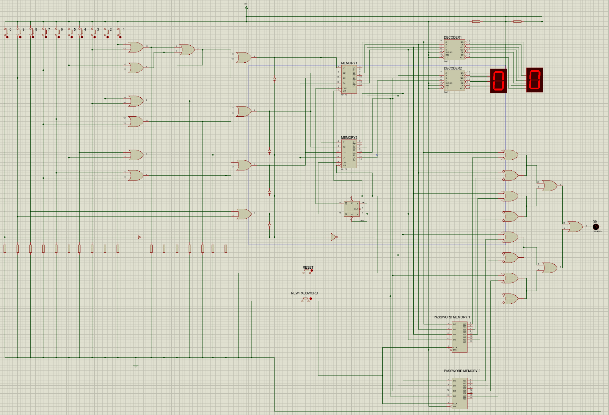
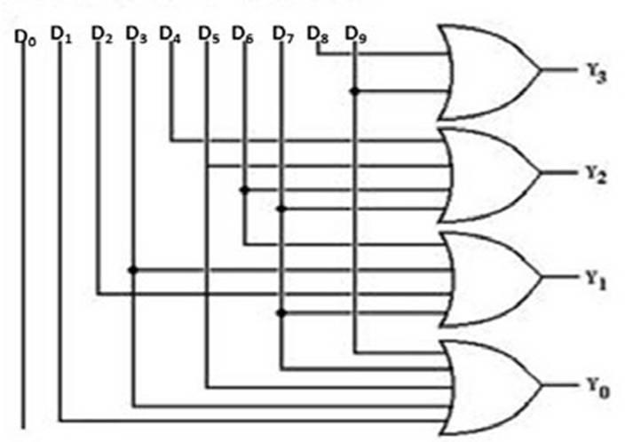
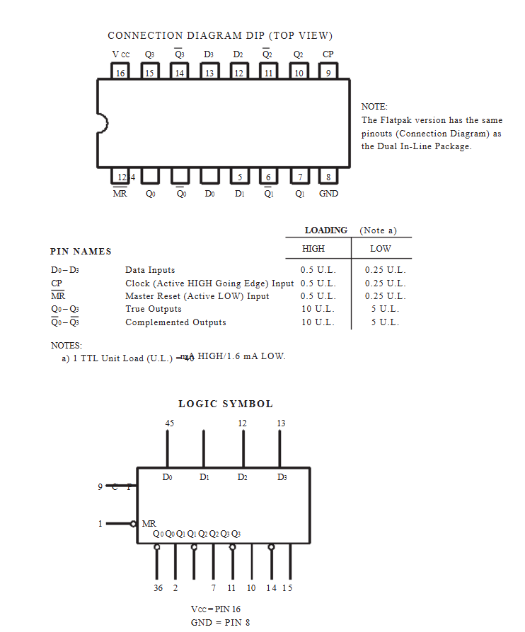
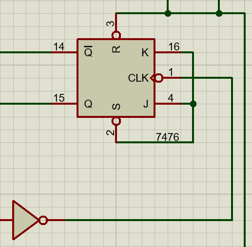
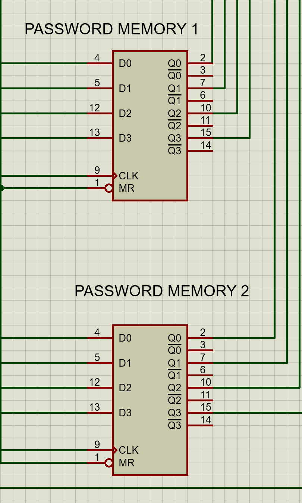
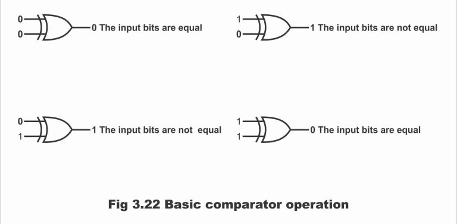
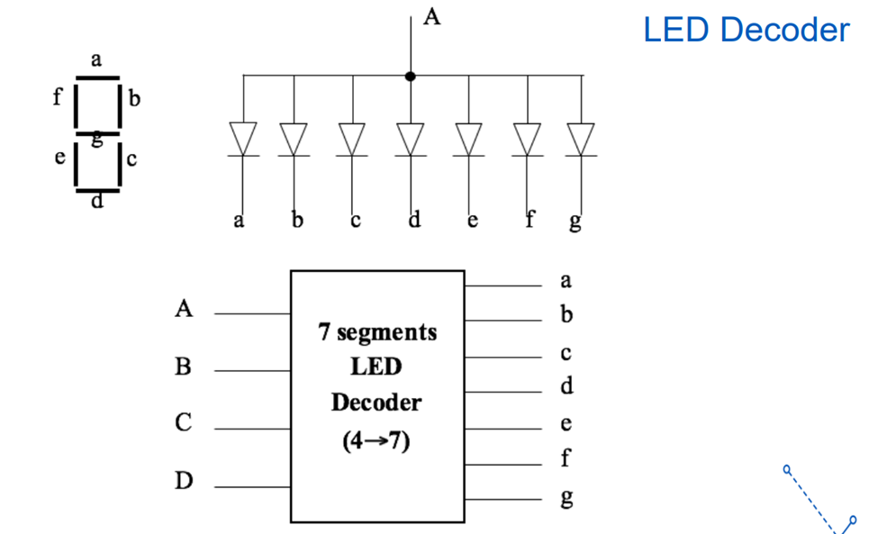

# Digital Combination Lock (Proteus Simulation)

[](https://www.labcenter.com/)
[](https://en.wikipedia.org/wiki/Transistor%E2%80%93transistor_logic)
[](https://dut.udn.vn/)
[](https://fast.dut.udn.vn/)
[](LICENSE)

A discrete digital logic circuit project implementing an electronic **2-Digit Digital Combination Lock** simulated in **Proteus Design Suite**. The circuit is built entirely from foundational combinational and sequential digital logic components—including decimal-to-BCD encoders, dual quad D flip-flops (74LS175), a JK flip-flop (7476) write steering unit, password memory registers, bitwise comparators, and BCD-to-7-segment decoders—without any microcontrollers or firmware.

Developed as a Course Project for **Digital Logic Circuit (Mạch Logic Số)** at the **Faculty of Advanced Science and Technology (FAST), The University of Danang – University of Science and Technology (DUT)**.

> [!NOTE]
> **Simulation-Only Project:** This repository contains the complete schematic design and interactive simulation built in **Proteus 8**. It represents a pure digital logic gate-level implementation designed for academic verification and analysis.

---

## Table of Contents
- [Circuit Overview](#circuit-overview)
- [Full Proteus Schematic](#full-proteus-schematic)
- [Modular Circuit Breakdown](#modular-circuit-breakdown)
  - [1. Decimal-to-BCD Encoder](#1-decimal-to-bcd-encoder)
  - [2. Memory Input & JK Flip-Flop Write Control Unit](#2-memory-input--jk-flip-flop-write-control-unit)
  - [3. Password Memory Blocks (PMB)](#3-password-memory-blocks-pmb)
  - [4. Bitwise Digital Comparator](#4-bitwise-digital-comparator)
  - [5. BCD to 7-Segment Display Decoder](#5-bcd-to-7-segment-display-decoder)
- [How to Run the Simulation](#how-to-run-the-simulation)
- [Repository Structure](#repository-structure)
- [Project Team & Contributions](#project-team--contributions)
- [License & References](#license--references)

---

## Circuit Overview

The system implements a secure combination lock mechanism requiring the user to sequentially enter two decimal digits (0–9) to disengage the lock:

```
[Keypad / Switches 0-9]
          │
          ▼
[Decimal-to-BCD Encoder]
          │ (4-bit BCD)
          ▼
[Memory Input Unit: 2x 74LS175 Quad D Flip-Flops] ◄── [JK Flip-Flop 7476 Write Steering Unit]
          │
          ├───────────────────────────────┐
          ▼                               ▼
[8-Bit Comparator Block] ◄─── [Password Memory Block]   [BCD to 7-Segment Decoders]
          │                           (Preset Code)               │
          ▼                                                       ▼
[Lock / Unlock Indicator LED]                           [Dual 7-Segment Displays]
```

### Operational Highlights
- **Sequential Input Handling:** The user inputs the first digit, followed by the second digit. A toggle JK flip-flop automatically routes the clock pulse so that Digit 1 and Digit 2 are latched into separate 4-bit registers.
- **Passcode Matching:** The 8 bits of entered data (2 digits $\times$ 4 bits BCD) are compared in parallel against the stored preset password.
- **Lock State Indicator:** When the entered code matches the master password, the lock output transitions to low (LED turns OFF), indicating the lock has successfully opened.

---

## Full Proteus Schematic

The complete circuit diagram modeled and verified inside Proteus Design Suite:



---

## Modular Circuit Breakdown

### 1. Decimal-to-BCD Encoder
Converts active-high inputs from 10 momentary switches ($D_0 - D_9$) into a standard 4-bit Binary-Coded Decimal (BCD) word ($Y_3 Y_2 Y_1 Y_0$):



**Boolean Expressions (Minterms):**
- $Y_0 = D_1 + D_3 + D_5 + D_7 + D_9$
- $Y_1 = D_2 + D_3 + D_6 + D_7$
- $Y_2 = D_4 + D_5 + D_6 + D_7$
- $Y_3 = D_8 + D_9$

Implemented purely using multi-input OR logic gates.

---

### 2. Memory Input & JK Flip-Flop Write Control Unit
*(Module Designed by **Nguyen Dang Khoa**)*

This module acts as the temporary data latch and sequential steering controller for the two incoming digits.

| IC 74LS175 Quad D Flip-Flop | JK Flip-Flop (7476) Write Control |
| :---: | :---: |
|  |  |

- **Storage Registers (Dual 74LS175):** Two positive-edge-triggered Quad D-type flip-flop ICs provide 8 bits of synchronous temporary storage (4 bits for Digit 1, 4 bits for Digit 2).
- **Sequential Steering Logic (IC 7476):** A JK flip-flop wired in toggle mode ($J = K = 1$) toggles its output state ($Q = 0 \leftrightarrow 1$) upon each button press. 
  - When $Q = 1$, the clock pulse is routed to latch the first digit into Register 1.
  - When $Q = 0$, the clock path is steered to latch the subsequent digit into Register 2.

---

### 3. Password Memory Blocks (PMB)
Stores the preset authorized password against which incoming codes are verified:



- Maintains the preset binary values for both digits.
- Features a "New Pass" trigger input capable of overwriting the stored password registers with newly entered digits.

---

### 4. Bitwise Digital Comparator
Performs real-time identity checking between the entered digits and stored password bits:



- Each corresponding bit pair is fed into a NOR gate. When both inputs match ($0 = 0$ or $1 = 1$), the gate evaluates to logic 0.
- When all 8 bit pairs evaluate to equality, the master output signals a match, driving the unlock indicator.

---

### 5. BCD to 7-Segment Display Decoder
Provides immediate numerical visual feedback for the user by driving two Common Anode 7-segment displays:



- Converts the 4-bit BCD outputs into 7 active-low control lines ($a, b, c, d, e, f, g$) derived through Karnaugh Map (K-map) minimization.

---

## How to Run the Simulation

1. **Prerequisites:** Install **Proteus 8 Professional** (v8.9 or higher recommended).
2. **Clone the Repository:**
   ```bash
   git clone https://github.com/khoahackvine-lang/Digital-Combination-Lock-Proteus.git
   cd Digital-Combination-Lock-Proteus
   ```
3. **Open the Project:**
   Double-click `combinationlock.pdsprj` to launch the schematic in Proteus ISIS.
4. **Start Simulation:**
   Click the **Play / Run Simulation** button at the bottom left toolbar.
5. **Interactive Testing:**
   - Press any switch (0–9) to enter the first digit (observed on Display 1).
   - Press another switch (0–9) to enter the second digit (observed on Display 2).
   - Verify that when the entered code matches the preset passcode, the lock output LED deactivates (indicating unlocked state).

---

## Repository Structure

```
Digital-Combination-Lock-Proteus/
├── combinationlock.pdsprj                 # Proteus 8 Design Suite project & schematic
├── Digital_Combination_Lock_Report.pdf    # Full 15-page academic project report (PDF)
├── Digital_Combination_Lock_Presentation.pptx # Project presentation slides
├── images/                                # Circuit schematics & logic diagrams
│   ├── proteus_circuit_simulation.png     # Full high-res schematic
│   ├── decimal_to_bcd_encoder.jpeg        # Encoder gate matrix
│   ├── ic_74ls175_d_flipflop.png          # Quad D flip-flop architecture
│   ├── jk_flipflop_write_control.png      # Write steering unit
│   ├── password_memory_blocks.png         # Password storage architecture
│   ├── comparator_logic.png               # Bitwise comparator gates
│   └── seven_segment_decoder.png          # 7-Segment decoder logic
├── .gitignore                             # Git ignore rules for Proteus backups
├── LICENSE                                # MIT License
└── README.md                              # Project documentation
```

---

## Project Team & Contributions

- **Course:** Digital Logic Circuit (Mạch Logic Số) – Class 23ECE
- **Faculty:** Faculty of Advanced Science and Technology (FAST), DUT
- **Project Supervisor:** Nguyễn Quang Như Quỳnh
- **Team Members & Responsibilities:**
  - **Nguyễn Đăng Khoa (ID: 123230072)** — Memory Input and JK Flip-Flop Write Control Unit Design
  - Vũ Nguyên Hồng Sơn (ID: 123230086) — Comparator Block & Circuit Simulation
  - Trương Duy Bảo (ID: 123230055) — Password Memory Block Design
  - Trần Lê Quốc Hưng (ID: 123230066) — BCD to 7-Segment Display Decoder Block
  - Nguyễn Thị Mỹ Duyên (ID: 123230059) — Decimal to BCD Encoder Block

---

## License & References

This project is licensed under the MIT License - see the [LICENSE](LICENSE) file for details.

### References
- Stephen Brown and Zvonko Vranesic (2013), *Fundamentals of Digital Logic with Verilog Design* (3rd ed), McGraw Hill.
- M. Morris Mano & Michael D. Ciletti (2012), *Digital Design* (5th Edition), Pearson.
- ON Semiconductor, *74LS175 Quad D-Type Flip-Flop Datasheet*.
